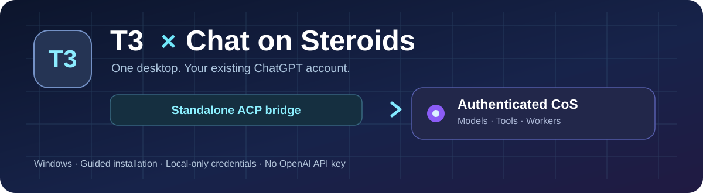

# Chat on Steroids for T3 Code

**Use your existing ChatGPT account, models and CoS tools inside T3 Code.**

**[Get started](#-installation)** · **[What works](#-capabilities)** · **[Troubleshooting](#-troubleshooting)** · **[Technical docs](docs/TECHNICAL.md)**

---

### Two apps. One workflow.

T3 Code provides the conversation UI, model picker, and thread management. Chat on Steroids (CoS) remains your authenticated ChatGPT execution runtime with its own tools, browser, and permissions. This independent bridge connects them using the local **Agent Client Protocol (ACP)**.

~~~mermaid
flowchart LR
    A["T3 Code desktop / mobile viewer"] -->|"ACP (local)"| B["Standalone T3–CoS bridge"]
    B -->|"Authenticated Windows-local control"| C["Chat on Steroids"]
    C --> D["Your existing ChatGPT account"]
~~~

> [!IMPORTANT]
> This is an independent community integration, not an official T3 Code, Chat on Steroids, or OpenAI release. **Windows desktop is required** for the bridge. The official T3 mobile app can access a connected desktop server; no extra iOS adapter is installed.

## ✨ Installation

**The easiest way is the guided Windows setup. No terminal commands required.**

### **[Download the latest source ZIP](https://github.com/BrannonSD/t3-cos-acp-bridge/archive/refs/heads/main.zip)**

1. **Install the prerequisites:** [T3 Code for Windows](https://github.com/pingdotgg/t3code/releases), the official [**Chat on Steroids desktop app**](https://github.com/totec448-spec/chat-on-steroids/releases), and [Node.js 26.12.1+ (Node 26) with npm](https://nodejs.org/en/download). Open T3 once; sign in to CoS and enable its local control API and actions.
2. **Extract the whole ZIP.** Open the extracted folder.
3. **Double-click `Install.cmd`.** Follow the guided installer: system check → preferences → installation → finish.
4. **Open T3 Code.** Refresh the Providers screen if needed, choose **Chat on Steroids** from the provider/model picker, and try a new chat.

The wizard checks prerequisites, registers the provider, and installs a verified local release. It displays live progress and error details, without modifying the CoS app or making a second ChatGPT account. On first installation it downloads npm dependencies, so internet access is required.

**Windows may show a security warning** because this is source-distributed PowerShell, not a code-signed installer. Review [Install.cmd](Install.cmd) and [scripts/setup-wizard.ps1](scripts/setup-wizard.ps1) before running them. The launcher uses `-ExecutionPolicy Bypass` for this process only and does not change your system-wide PowerShell policy.

<strong>Prefer PowerShell or automation?</strong>

From the extracted repository directory:

~~~powershell
powershell.exe -NoProfile -ExecutionPolicy Bypass -File scripts/install.ps1 -Mode existing-install -AutoStartMain -RegisterT3
~~~

For a read-only prerequisite report:

~~~powershell
powershell.exe -NoProfile -ExecutionPolicy Bypass -File scripts/setup-wizard.ps1 -CheckOnly
~~~

The core installer remains noninteractive and supports `-InstallRoot`, `-NodePath`, and omitting `-RegisterT3` or `-AutoStartMain`. See the [technical installation reference](docs/TECHNICAL.md#portable-windows-source-installation).

## 🔄 Updating safely

**Your conversations are more important than an update.** The wizard never silently stops an active T3-CoS turn or swaps a live bridge.

1. Finish any running Chat on Steroids requests in T3.
2. In **T3 → Settings → Providers**, disable **only** Chat on Steroids.
3. Run the wizard from the new download and select **Refresh checks**.
4. Complete setup, then refresh the provider in T3.

An existing enabled provider is a deliberate upgrade blocker. Your private bridge SQLite data, CoS login, T3 conversation history and unrelated providers remain in place. For recovery, see [release safety and rollback](docs/TECHNICAL.md#compatibility-and-state-evolution).

## 🧩 Capabilities

| Capability | Status on stock apps |
|---|---|
| Existing ChatGPT login, no API key | ✅ Supported |
| Create, resume and follow up in T3 | ✅ Supported |
| CoS account model catalog and reasoning effort | ✅ Supported |
| Live response, tool activity, and correct final-answer selection | ✅ Supported |
| Projectless chats and known CoS project binding | ✅ Supported |
| CoS tools, files, browser and plugins | ✅ Owned by CoS, subject to its grants |
| Worker status and selected parent-linked activity | ✅ Observational tool cards |
| Image/file inputs | ⚠️ Staged under an approved local CoS root, not native ChatGPT uploads |
| Separate navigable T3 child-agent threads | ⏳ Requires upstream T3 support |
| Change Goal/Loop or force native compaction from T3 | ⏳ Requires upstream CoS API support |
| Independent native iOS runtime | Not needed; T3 mobile connects to desktop |

CoS's own tool approval dialogs and permission policy remain authoritative in stock mode. T3 cannot override them.

## 🔒 Privacy & security

- **Local-only control:** the bridge communicates with CoS's authenticated local control interface. Tokens are never placed in the T3 provider configuration or committed to Git.
- **Private persistence:** runtime session mappings and receipts live under your Windows user's LocalAppData, separate from this repository.
- **No packaged user data:** this repo and the downloadable source ZIP exclude browser profiles, CoS credentials, personal paths, T3 settings, or private transcripts.
- **Guarded upgrades:** immutable verified releases, backups of T3 provider settings, preflight checks and fail-closed input recovery.
- **Reviewable source:** run `npm run audit:public`, `npm run check`, and `npm test`; GitHub Actions validates Windows builds.

Read [SECURITY.md](SECURITY.md) for threat boundaries and limitations. Automated secret scans reduce the risk of accidental disclosure, but cannot guarantee the absence of every possible sensitive value.

## 🛠️ Troubleshooting

<strong>The wizard says T3 Code is missing</strong>

Open the installed T3 desktop application at least once. The wizard looks for that Windows user's normal T3 settings file. It does not create a fake application installation.

<strong>Node.js or npm is missing</strong>

Install Node.js 26.12.1 or a later Node 26 patch including npm from [nodejs.org](https://nodejs.org/en/download), then reopen the wizard. It uses your normal `node.exe` on PATH instead of a machine-specific bundled runtime.

<strong>The wizard won't upgrade an existing integration</strong>

Finish the running T3-CoS session, disable the Chat on Steroids provider in **T3 Settings → Providers**, and click **Refresh checks**. Do not delete SQLite state, provider settings, or your CoS profile to force an upgrade.

<strong>The provider appears, but replies cannot start</strong>

Open CoS and check that you're signed in, **local control API** and **actions** are enabled, and the app is running. Restart or refresh the T3 provider view. For advanced diagnosis use the installed CLI with `--diagnose`, or see the [technical reference](docs/TECHNICAL.md).

<strong>Images or project files aren't available</strong>

The stock CoS control API cannot receive native ChatGPT attachments through this bridge. Files are securely staged under a CoS-approved local root for CoS to inspect with its own file/image tools. Add the desired folder to CoS's approved roots when necessary.

## For maintainers

The installer is intentionally **source-first** rather than a prepackaged unsigned `.exe`. It uses native Windows PowerShell/WPF for the UI, with the same audited PowerShell installer behind both CLI and wizard. There is no web-hosted installation agent, no cloud bridge service, and no additional authentication token.

The in-depth implementation, runtime compatibility, recovery, worker behavior and ACP details live in **[docs/TECHNICAL.md](docs/TECHNICAL.md)**. The repository itself is not an official support channel for upstream T3 or CoS application issues.

Built as a standalone integration. T3 Code, Chat on Steroids and ChatGPT are trademarks of their respective owners.
